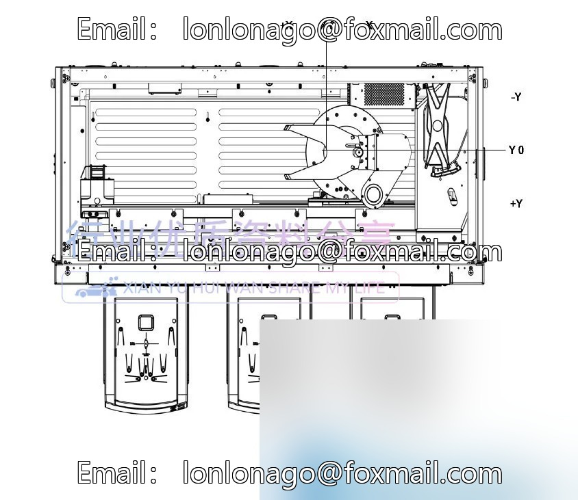
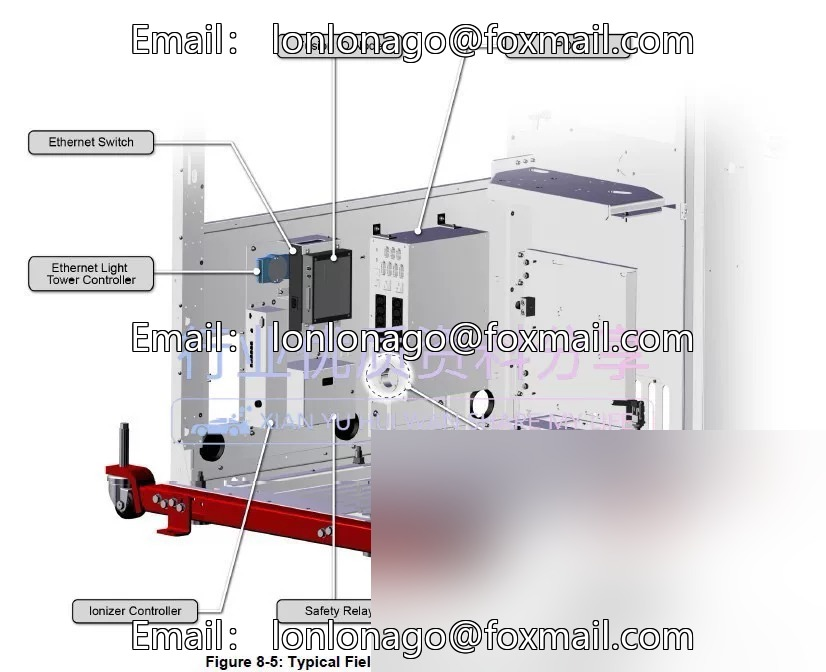
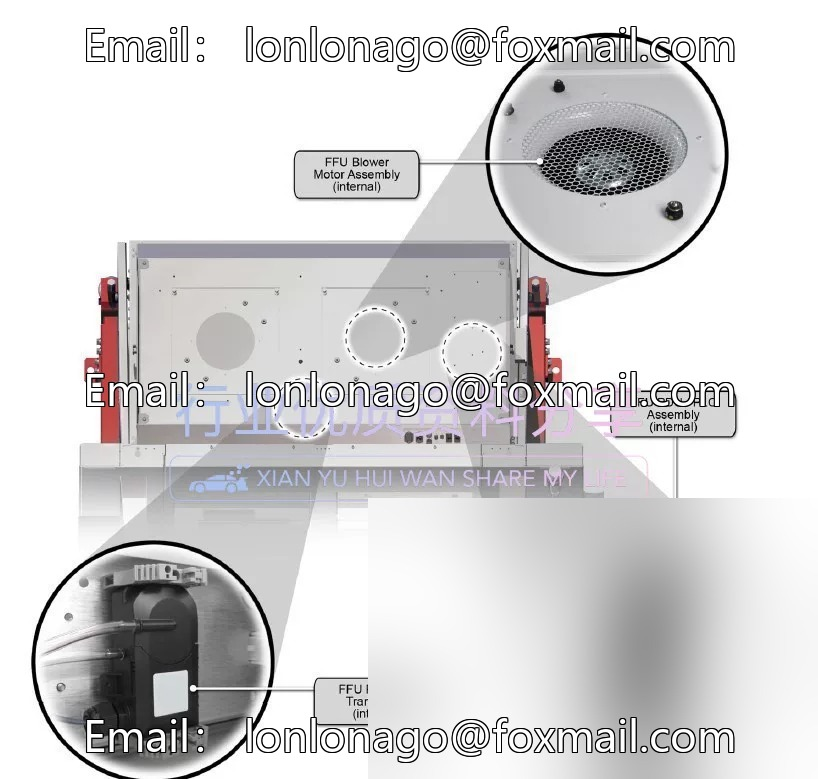
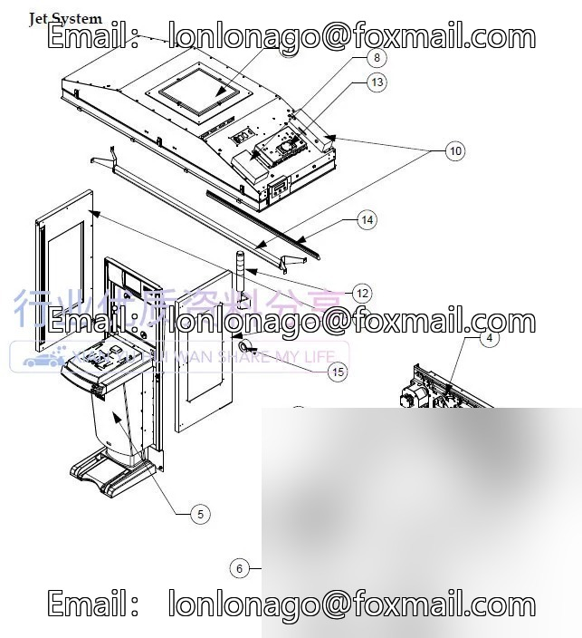
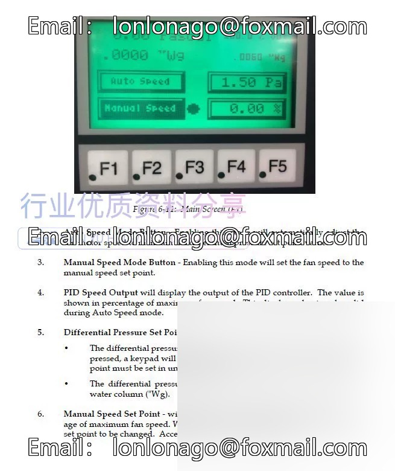
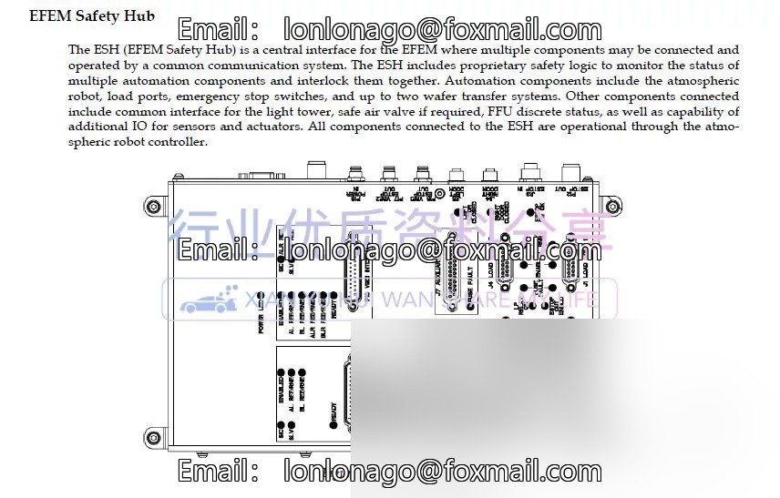
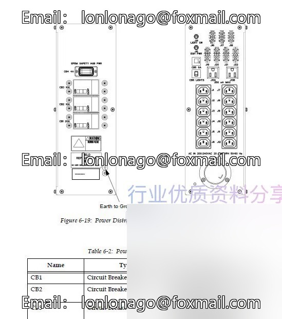
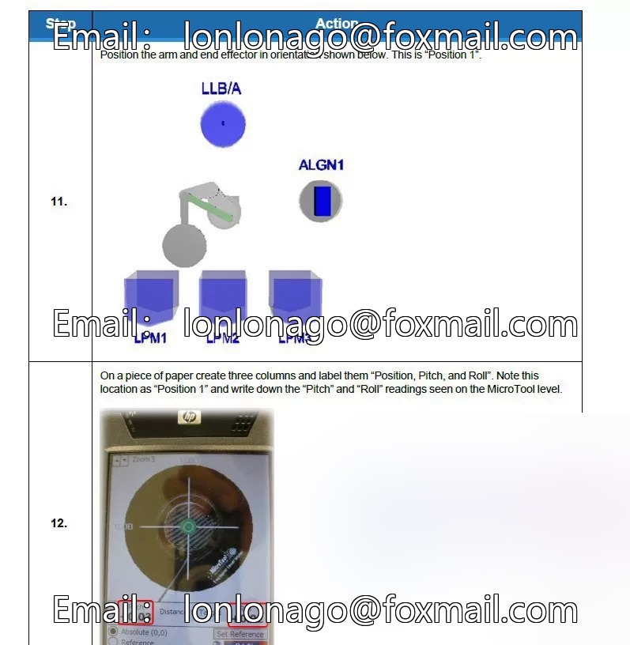

# Brooks BROOKS JCP Wafer Transport Platform User Manual , including 2

## Body

Brooks BROOKS JCP wafer transfer platform user manual for sale, including two versions of 2014 and 2023, which in detail introduces the structure and operation and maintenance methods of the EFEM system, and has very valuable reference value. The materials are sold in a per unit/instance form.

Reason for submitting: Organize materials and share with friends who need them.
After-sales explanation: The materials are virtual products, and they will not be refunded upon sale.

Friends with an interest can private chat with me~

The sold user manual for the Brookses JCP wafer transfer platform includes versions from 2014 and 2023, detailing the EFEM system's structure and operation/maintenance methods; the materials are sold in the form of yuan per usage.

<!-- AI_ENRICHED -->

## Images

## Payment

Here is a pay link on Stripe ( https://buy.stripe.com/3cs8yP7sY87d0vu9AB ). Please contact me lonlonago@foxmail.com after funding $89, and I will send you a complete data files , thank you!

